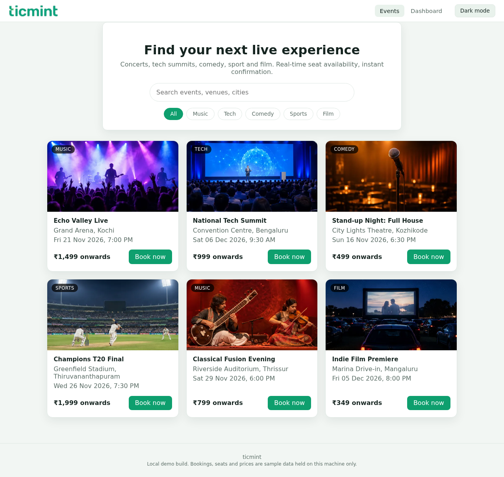
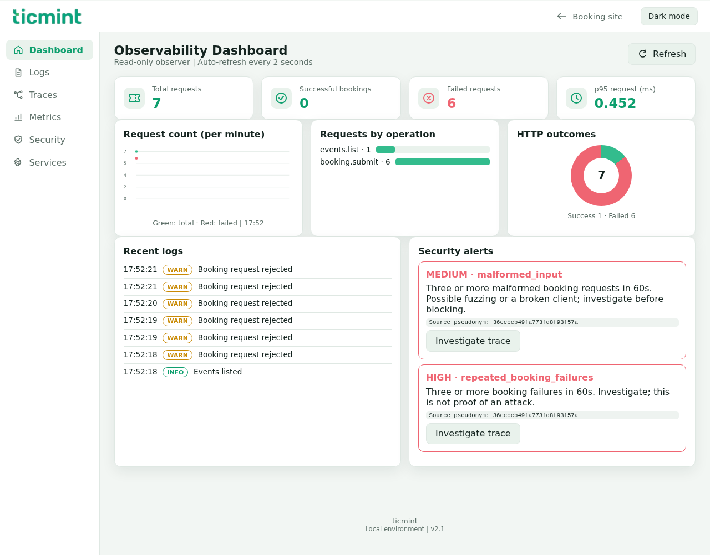

# ticmint - secure ticketing with observability

An easy-to-run Python ticket-booking web application with a connected observability dashboard: structured logs, trace/span correlation, request charts and cybersecurity alerts, all fed live by real booking activity.

This is a **fresh reference implementation**, not recovered internship source code or Ticmint production software. The events, seats and prices are sample data. No company document, certificate, personal details, payment data or real customer traffic is included.





More captures, including dark mode, security alerts and mobile, are in [evidence/screenshots.md](evidence/screenshots.md) and the [v2.0.0 release notes](https://github.com/hadhiabdulla/secure-ticketing-observability/releases/tag/v2.0.0).

## Quick start

Requirements: Python 3.10 or newer. Internet is needed once to install Flask. No Docker, Node.js, cloud account, database or API key is required.

1. Download the repository ZIP from GitHub's **Code → Download ZIP**, then extract it.
2. On Windows, double-click **run.bat**. This creates a virtual environment, installs Flask and opens the app. If `py` is missing, install Python from https://www.python.org/downloads/ and enable the launcher.
3. On macOS/Linux, run `sh run.sh`, then open **http://127.0.0.1:5000**.

### Using git and the command line

```sh
git clone https://github.com/hadhiabdulla/secure-ticketing-observability.git
cd secure-ticketing-observability
python -m venv .venv
# Windows (cmd):  .venv\Scripts\activate
# macOS/Linux:    source .venv/bin/activate
python -m pip install -r requirements.txt
python app.py
```

Keep the terminal open and open **http://127.0.0.1:5000**. Press Ctrl+C to stop. If port 5000 is already in use, set `PORT` before starting app.py and open that port instead. The server binds to loopback only.

## The two apps

- **Booking site** (`/`): a customer-facing ticketing website. Six sample events across music, tech, comedy, sport and film, search and category filters, a real seat map with multi-seat selection, an order summary with per-event pricing in rupees, and booking confirmation with references.
- **Observability dashboard** (`/dashboard`): summary cards, per-minute request charts, requests by operation, HTTP outcome donut, searchable JSON logs, a trace explorer with span waterfall and correlated logs, a security view, and one-click traffic/attack scenarios. The booking site and dashboard share one backend: every booking, failure and scenario run appears live in the dashboard.

Both apps have a **dark/light mode** toggle in the header (remembered per browser, following the system preference by default).

## Demo in two minutes

1. Open **http://127.0.0.1:5000**, pick an event, select two seats and confirm the booking.
2. Open **Observability dashboard** from the header: counts, request charts and logs already show your activity.
3. Open **Traces**, select a booking and inspect its spans and matching JSON logs.
4. Open **Scenarios** and run **Repeated booking failures** and **Bot burst**; both are real HTTP request runs.
5. Open **Security** to see the HIGH repeated-failure alert and the MEDIUM request-burst alert, then **Investigate trace** to follow an alert into its failed request.
6. Flip **Dark mode** in the header on either app.

## Features

- Customer-facing booking site with search, category filters, seat map, multi-seat orders and booking references.
- Separate observability dashboard fed live by the same Flask backend.
- Dark and light themes on both apps.
- Seat reservation protected by a lock: concurrent requests cannot book the same seat twice.
- Five one-click scenarios: customer browsing, concurrent booking rush, repeated failures (HIGH alert), bot burst (MEDIUM alert) and malformed-input rejection.
- Explicit EVENT_NOT_FOUND, SEAT_NOT_FOUND and SEAT_UNAVAILABLE responses.
- Structured JSON logs with timestamp, level, service, region, partner_id, trace_id and span_id.
- Root request spans and child inventory/persistence spans with measured durations.
- HIGH alert after 3 booking failures from the same pseudonymous source in 60 seconds; MEDIUM alert after 8 booking attempts in 10 seconds; alert deduplication.
- Security view lists the live HTTP protections (CSP, nosniff, no-store), the cross-origin POST block and the data-minimization rules.
- Privacy-focused field allowlist, process-local HMAC source pseudonyms, cross-origin POST checks and restrictive browser headers.
- Mobile layout, Windows launcher, repeatable demo and automated tests.

## Real run evidence

Run the tests and regenerate the deterministic scenario:

```sh
python -m unittest discover -s tests -v
python demo.py
```

The included test run passed **24 tests**. `demo.py` actually executed 7 requests: event discovery, seat lookup, 2 successful bookings and 3 failures, creating 1 HIGH alert. Trace IDs, timestamps and timings change every run.

Evidence files:

- `evidence/test-results.txt`: captured unittest output.
- `evidence/demo-responses.json`: actual request results.
- `evidence/observability.json`: correlated traces, logs and alert from demo.py.
- `evidence/screenshots.md`: dashboard, booking site, security, trace and mobile screenshots captured from the running application.
- `evidence/ui-results.json`: completed browser checks, no JavaScript errors and no mobile horizontal overflow.

The UI structure and theme follow the supplied internship report's layout; it is not a pixel-for-pixel copy. Unimplemented payment/authentication services and the report's static volumes are deliberately not presented as live features.

## Files and API

```text
app.py          Flask routes: booking site, dashboard, local JSON API
core.py         events/inventory, trace/span model, logger and security monitor
demo.py         executable evidence scenario
templates/      booking.html (booking site) and index.html (dashboard)
static/         local CSS and JavaScript, shared theme toggle (no CDNs)
tests/          unittest suite
docs/           architecture, report mapping and incident runbook
evidence/       captured outputs from actual runs
artifacts/      runtime JSONL logs/traces/alerts (git-ignored)
```

| Endpoint | Purpose |
|---|---|
| GET / | Booking website |
| GET /dashboard | Observability dashboard |
| GET /api/events | List sample events with prices |
| GET /api/events/{event_id}/seats | Read seat availability |
| POST /api/bookings | Submit JSON event_id and seat |
| GET /api/observability | Current dashboard snapshot |
| GET /api/traces/{trace_id} | Trace and correlated logs |

## Important limits

- This models correlation in one process. It is **not distributed tracing**, W3C trace context propagation, OpenTelemetry or Grafana Cloud integration.
- Inventory and dashboard state are in memory and reset when the server restarts. JSONL evidence files append across runs; deleting artifacts/ clears saved evidence. They are not replayed into state.
- There is one fixed demo actor/partner. No real multi-tenant isolation, login, authorization, payment, email or SMS is implemented. The checkout takes no payment and collects no personal details.
- The failure and burst rules are demo signals, not proven intrusion detectors. A legitimate booking rush can trigger them. They do not block IPs or users.
- No raw IP, email, phone, address or payment field is logged. Source pseudonyms are keyed per process and cannot correlate across restarts. Do not enter real personal data into this demo.
- Memory and JSONL files are not bounded; keep runs short. Do not deploy publicly, reverse-proxy or expose this Flask development server to a network.
- The source plan's cloud rollout, senior reviews, Jira/Slack setup and production definition of done are not claimed complete.

See [architecture](docs/architecture.md), [report mapping](docs/report-mapping.md) and [security runbook](docs/security-runbook.md).
