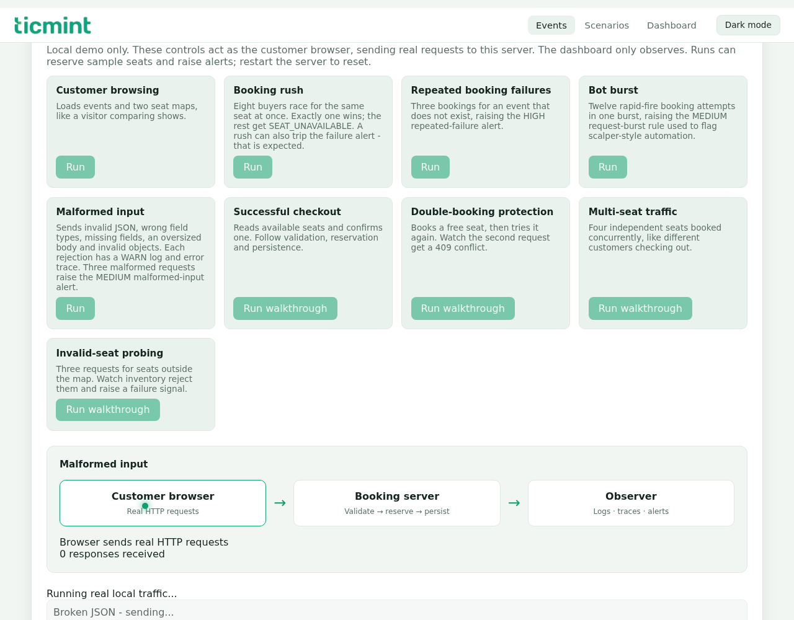
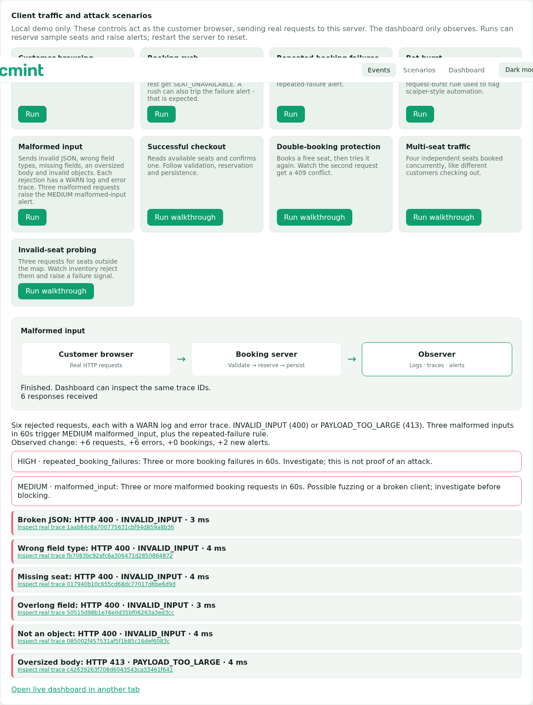
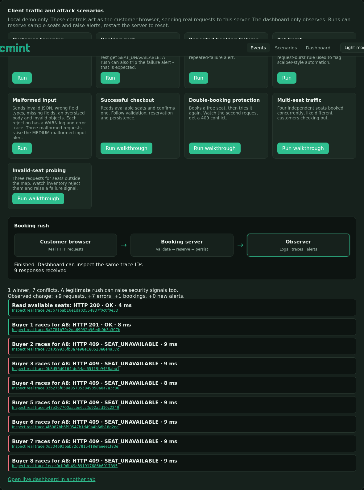
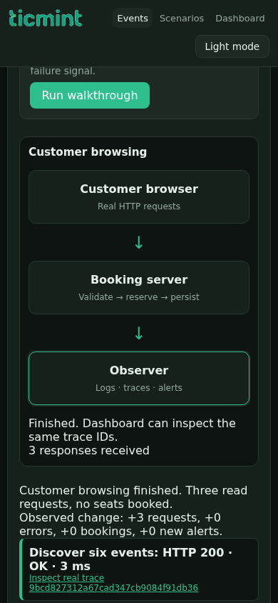
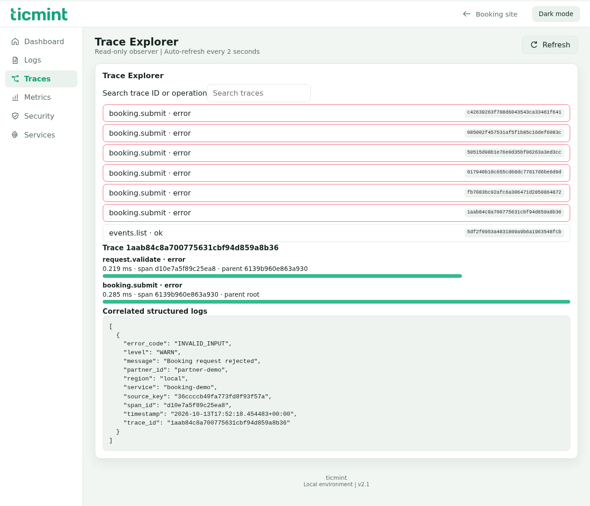
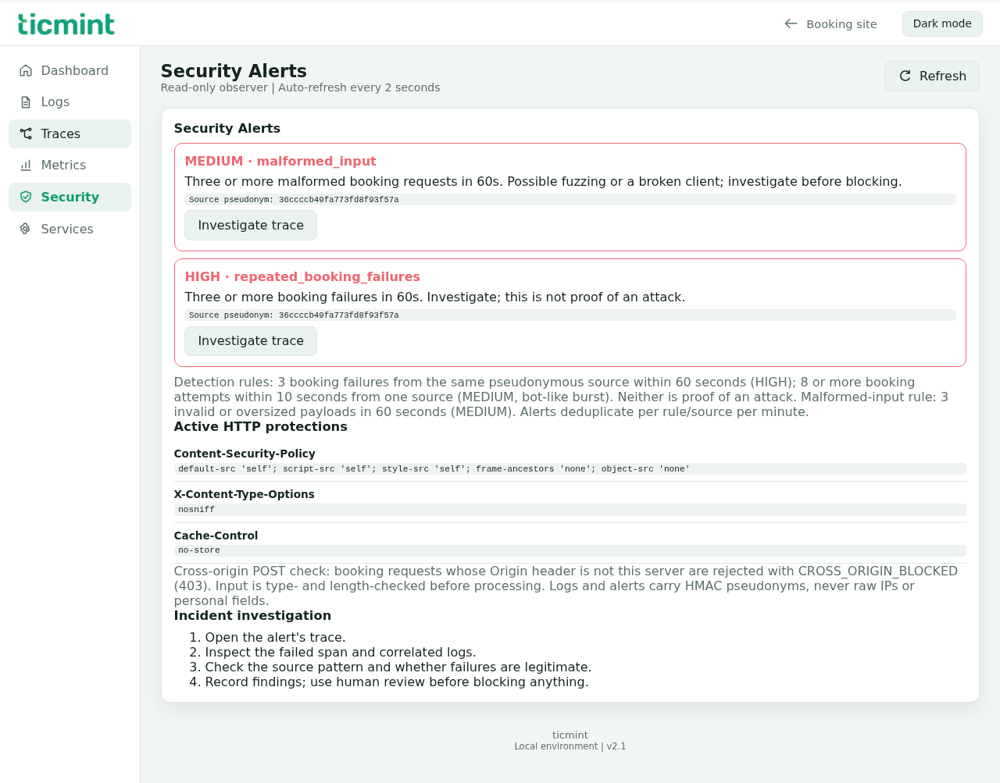
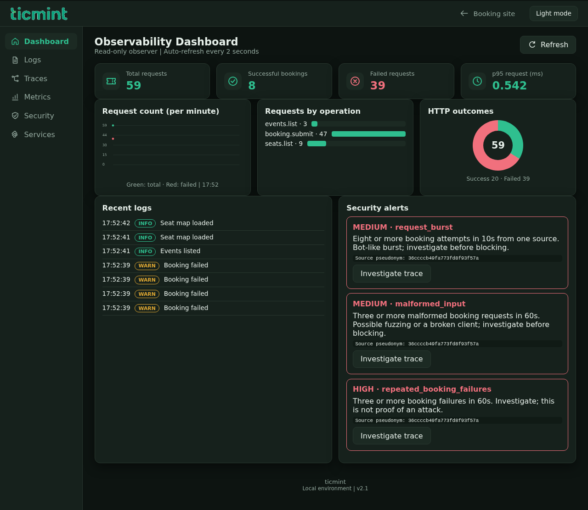
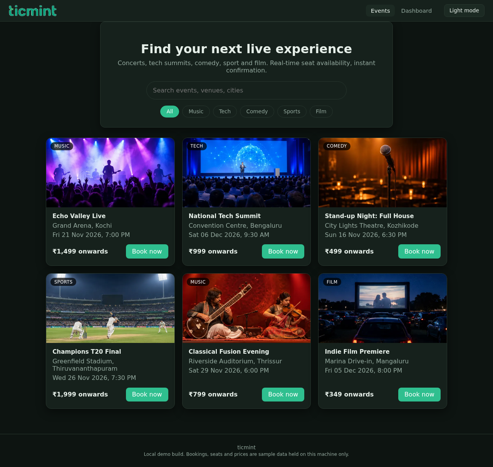
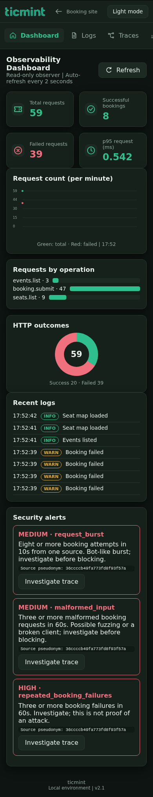
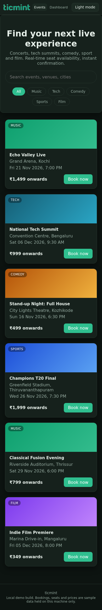

# Actual-run screenshots

## Client-side walkthroughs and malformed-input fix (v2.1)

Nine scenarios now run on the customer page. The dashboard only reads and refreshes. Actual Chromium screenshots, 2026-10-13.

## Updated logo and report-style icons (2026-10-13)

Captured from the running app after browsing, a booking rush, repeated failures and a request burst. The wordmark is the supplied logo with its white padding removed. All icons are local SVGs and remain readable in both themes.

## Earlier v2.0.0 screenshots

All images below were captured from the running application (Chromium, 2026-10-13), after real booking and scenario actions. Nothing here is copied from the supplied report PDF. The same set is attached to the [v2.0.0 release](https://github.com/hadhiabdulla/secure-ticketing-observability/releases/tag/v2.0.0).

## Booking site (light)

## Booking site (dark)

## Observability dashboard (light)

## Observability dashboard (dark)

## Security alerts (HIGH repeated failures, MEDIUM request burst)

## Mobile (390px)

